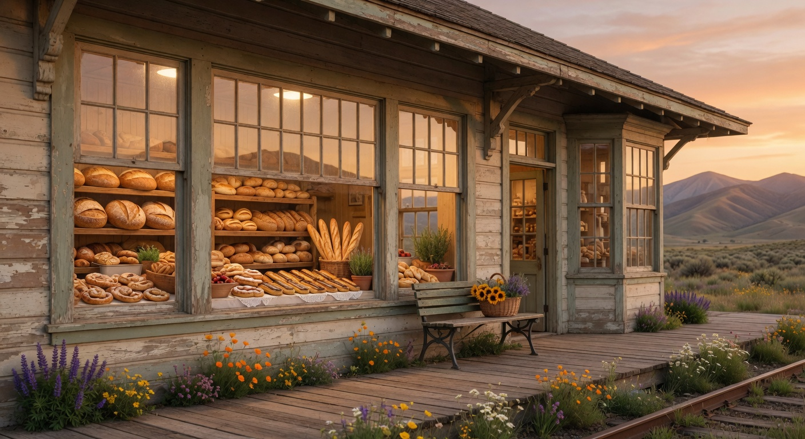

# The Last Stop Bakery & Mercantile

A beautiful, modern single-page website for a fictional artisan bakery and mercantile located in the restored 1898 train depot at the end of the line in Willow Creek, Colorado.



## Features

- Warm, rustic design system with custom Tailwind v4 theme (cream, terracotta, gold, deep brown)
- Fully responsive (mobile-first) with accessible sticky nav + hamburger
- Interactive menu with category filters (Breads, Pastries, Savories, Mercantile)
- Shopping basket simulation: add items, adjust quantities, running total, fake "place order for pickup" with success toast
- Image gallery with clickable lightbox + prev/next navigation
- Smooth scroll navigation with active section highlighting
- Contact form (client-side fake submit with success states + toasts)
- Subtle framer-motion animations (mobile menu, cart slide-in, presence)
- Beautiful custom photography generated for the brand

## Tech

- Vite + React 19 + TypeScript
- Tailwind CSS v4 (via @tailwindcss/vite)
- framer-motion
- lucide-react icons
- sonner (toasts)

## Getting started

```bash
cd last-stop-bakery
npm install
npm run dev
```

Then open http://localhost:5173

### Other scripts

- `npm run build` – production build (outputs to `dist/`)
- `npm run preview` – serve the production build locally
- `npm run lint` – ESLint

## Content & Customization

All menu items, copy, hours, address, and gallery captions live in `src/App.tsx`.

Images are in `public/images/` (hero + 6 gallery shots).

The cart is 100% client-side; "checkout" shows a toast and clears state. No backend.

## Notes

- Built following boring, proven patterns: Vite + React + TS + Tailwind.
- Emphasis on accessibility: semantic sections, ARIA labels, keyboard friendly, focus states.
- The "Last Stop" story is fictional but feels rooted and specific.

Enjoy the bread.

— Grok
